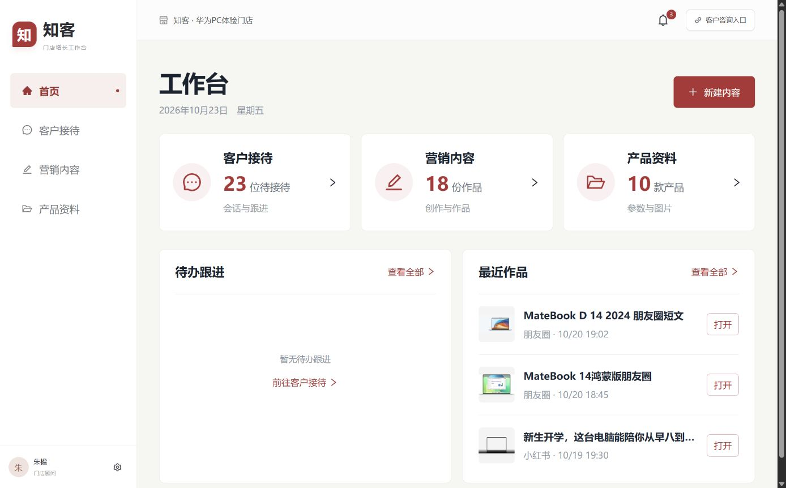
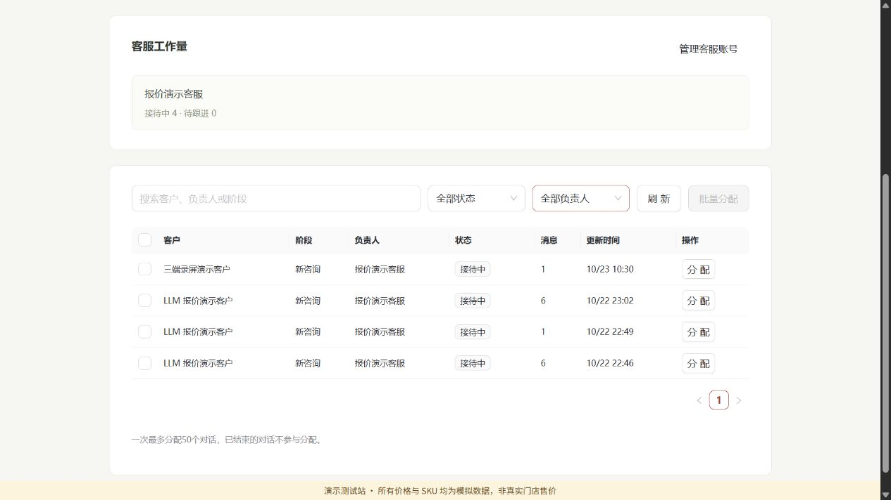
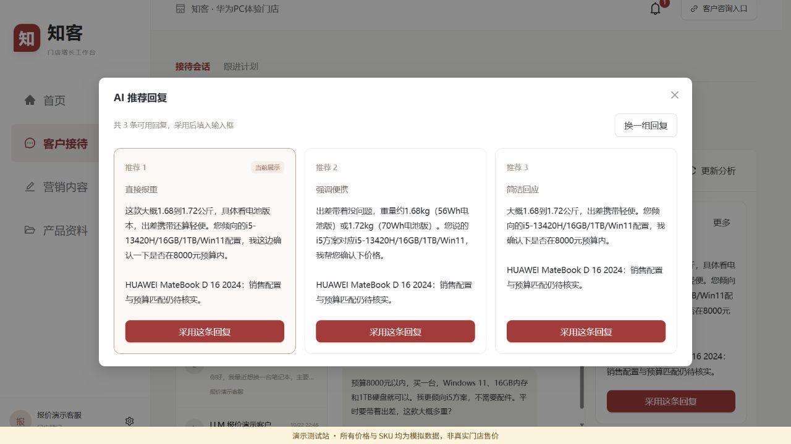
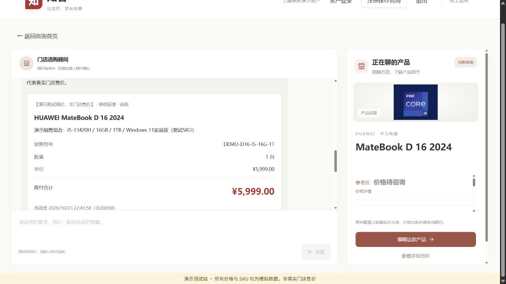
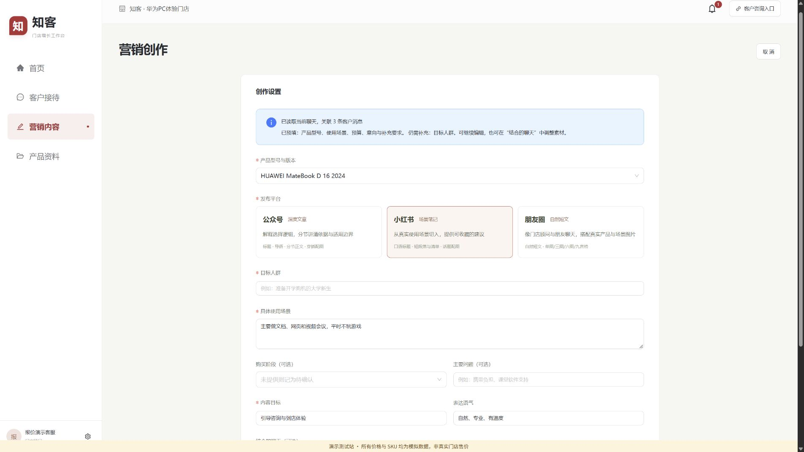

# 知客：华为 PC 门店增长工作台

作品说明书 · 比比拉布团队 · 华为·产业进阶赛道

版本：2026-10-23 · 本地功能与演示材料更新版

知客把客户咨询、门店接待、人工核实、规则报价与营销图文连接起来。客户提出购机需求，AI 根据上下文和资料准备建议，员工确认后发送；需要门店判断的事项进入核实流程，反馈后继续推进。营销人员可以从需求出发，也可以独立创建图文作品。

核心特点：三端协作、连续多轮对话、可追溯的核实闭环、规则驱动报价，以及按平台组织的营销内容。

本版配套视频约 2 分 24 秒，采用 1920×1080 全屏网页画面、晓晓中文女声与字幕，已缩短句间空白，并补录聊天需求导入与三类文案入口。视频展示客户端、客服端和管理员端，并保留从咨询、核实到报价反馈的关键操作。价格及销售组合均为演示测试数据。

材料范围：说明当前本地实现与已有验证证据，不代表全部赛题已验收或已正式提交。公网部署记录属于历史快照，本地新功能不据此宣称已同步上线。

## 01 三端协作与使用入口

| 角色 | 主要操作 | 在流程中的作用 |
| --- | --- | --- |
| 客户端 | 浏览产品、发起咨询、补充需求、接收回复与报价 | 保留同一会话，确认配置和购买意向 |
| 客服端 | 接待、采用 AI 建议、登记核实、反馈结果、结束接待 | 人工确认表达和事实，推进服务 |
| 管理员端 | 管理账号、分配会话、配置模型与知识库、维护报价规则 | 配置业务基础并查看运行状态 |

客服侧默认展示一条 AI 推荐回复，点击“更多”在居中弹窗中查看候选；目标为三条，通过检查的候选不足时不填充无效内容。采用建议后进入输入框，员工确认发送。已经接待的会话不能随意放弃，可以按流程结束接待。

本地正常站：127.0.0.1:8765；隔离报价演示站：localhost:8780。客户端入口为 /，客服为 /staff，管理员为 /admin。

管理员在“网站设置”中维护 AI 配置、知识库、报价规则和运行维护；账号管理与对话分配分别提供对应入口。密钥不回显，后端校验角色与操作权限。

## 02 多轮对话与人工核实闭环

服务主线为：理解需求 → 检索资料 → 补齐选购条件 → 确认配置 → 准备报价 → 反馈客户。模型结合历史消息、客户条件和当前待办生成下一步建议，程序维护状态与发送约束。

无法确认的兼容性、实际体验或动态售价形成核实事项。待核实只限制相关结论；已确认的信息仍可继续回答，独立的需求收集和配置选择继续推进，避免重复承诺“正在核实”却停止服务。

核实过程：待处理 → 核实中 → 已完成、待反馈 → 已反馈。员工填写结论、适用条件、来源与有效期；未确认时保留待办并调整期限。完成核实后 AI 准备客户反馈，员工发送后才记为已反馈。

价格事项需要关联准确 SKU 与实际发出的报价卡，不能仅因模型说了“已告知”就关闭。1/3/5 跟进计划与核实截止时间分开管理，用于后续购买意向跟进；本次视频不作为自动外呼、成交或全部跟进策略的验收证明。

## 03 四级报价与演示数据

报价金额由规则计算，模型负责解释。发送前重新校验配置、数量、税费、优惠资格、审批、有效期及报价签名，防止把过期或不适用的金额发给客户。比较阶段不附带旧报价；可选优惠待核验不阻断已经有效的报价。

| 级别 | 演示规则 | i5 / i9 示例金额 |
| --- | --- | --- |
| L1 基础报价 | 单机含税，数量 1-3 台，额外费用 0 | 5999 / 6999 元 |
| L2 资格优惠 | 演示教育资格审核后，每台减 300 元 | 5699 / 6699 元 |
| L3 组合报价 | 单机＋鼠标 199 元＋电脑包 99 元 | 6297 / 7297 元 |
| L4 专项审批 | 独立审批通过后才能提供正式金额 | 待审批时不发送金额 |

全部为演示测试数据，不代表华为官方或门店政策。示例配置为 MateBook D 16 2024，i5-13420H 或 i9-13900H、16GB、1TB、Windows 11 家庭版测试 SKU；两款共八条规则。各级是备选方案，不跨级叠加。原业务库真实报价规则仍为 0 条。

录制时这组规则有效期至北京时间 2026-10-23 22:41:58。视频保留当时结果，过期后演示需重新生成有效规则。录制中单机与组合备选同屏出现，回复仍需客服检查是否符合“只要单机”的要求。

## 04 三类文案与客户对话的关系

营销创作提供三类正文：公众号深度文章、小红书场景笔记、朋友圈自然短文。同一份客户需求按平台调整结构、语气、长度和配图；AI 海报为独立配套功能。

| 类型 | 表达重点与输出 |
| --- | --- |
| 公众号深度文章 | 标题、导语、分节正文，讲清选择依据与适用边界 |
| 小红书场景笔记 | 从具体场景切入，短段落、清单和话题配图 |
| 朋友圈自然短文 | 像顾问与朋友聊天，保留重点，搭配产品或场景图 |

会话详情中的“跟进与创作 → 转为营销创作任务”读取已确认的型号、场景、预算等，并关联具体客户消息；未确认的目标人群仍需补充。员工可以在“结合的聊天”中调整所选素材。

本次补录沿用同一位 D 16 客户，实际带入办公、网页、视频会议和 8000 元以内预算，并选中 3 条客户消息。聊天决定文案的场景与关注点，产品事实仍来自知识库。

ima 优先、失败时标明本地回退；作品保存来源与版本，修改后重新核验。模型检查与人工审核分别显示，确认后可预览和导出。视频后段的成稿仍是独立历史案例，本次补录验证需求导入与三类入口，未提交新的生成任务。

## 05 技术实现与本地运行

前端为 React、TypeScript 与 Ant Design；后端为 FastAPI、SQLAlchemy 与 SQLite。LLM 负责需求理解、表达、策略和核验建议，程序负责状态、权限、版本、精确报价和发送校验。本次真实对话使用 qwen3.8-27b。

| 层次 | 负责内容 |
| --- | --- |
| 界面与角色 | 客户、客服、管理员各自入口和操作范围 |
| 对话编排 | 历史上下文、需求主线、候选回复、核实待办 |
| 知识与内容 | ima 优先、本地回退、来源快照、营销版本 |
| 确定性规则 | 金额计算、资格与审批、过期校验、反馈关联 |
| 存储与运维 | 会话、作品、报价、日志及备份 |

模型接入通过管理员“网站设置 → AI 配置”维护。凭证由运行环境提供，不写入公开说明书；公开仓库不附带团队的真实账号、密钥和私有服务地址。

正常本地启动使用 scripts/start.ps1。报价演示使用 scripts/start-quote-demo.ps1，默认恢复已有隔离数据；报价过期后可使用 -Fresh 建立新演示数据。安装依赖与详细步骤以根目录 README 为准。

实际营销系统提示词位于 backend/prompts/marketing-system.txt。模型与 ima 接入说明见 docs/competition/API_CONFIGURATION.md 与 IMA_INTEGRATION.md；历史界面路径如有不同，以当前管理员页面为准。

当前本地模型链路依赖 18738 转发服务，连接中断会影响生成。系统保留已有记录并提供重试，但仍需可靠的模型服务和网络才能持续运行。

## 06 实际验证与录屏说明

2026-10-23 录制中新建客户会话，管理员实际分配给客服；客户补充预算 8000 元以内、单台、i5、16GB、1TB、Windows 11，随后请求含税报价。员工登记价格核实、生成反馈并发送报价卡，客户端收到，核实状态更新为已反馈，最后结束接待。

| 证据 | 已记录结果 |
| --- | --- |
| 本次会话 | 4 条客户消息、3 条客服消息，最终 closed |
| 模型与操作 | 客服回复真实 LLM 生成，经实际界面采用、发送 |
| 核实反馈 | 价格事项 completed，反馈 sent |
| 自动化回归快照 | 后端 507 项、前端 133 项通过，构建通过 |
| 追加边界回归 | SKU 精确匹配相关 11 项通过 |

客户输入是演示脚本，不把本次录屏描述为 LLM 自动生成客户消息。自动化通过不能证明所有真实对话永远正确；旧营销验收为两组 ima、一组真实接口失败后的本地回退，经修订与独立模型重验后通过。

成片时长约 2 分 24 秒，1920×1080，中文合成配音与画面字幕。使用真实网页连续帧分段剪辑，按语音重排镜头并适当调整网页操作播放速度，压缩模型等待和重复停留；被提示遮挡、未提交成功的点击尝试未进入成片，原始素材保留。它是功能介绍视频，不是未经剪辑的完整现场运行录像。

材料位置：output/competition-video-tight-20261023 保存配音成片、字幕和检查记录；output/competition-video-full-20261023 保存完整问答与三端验收 JSON；output/quote-full-chain-20261022 保存网站检查和报价规则。视频不作为已完成全部比赛任务矩阵的声明。

## 07 当前边界与交付清单

真实门店价格、库存、优惠资格及具体软件兼容性、散热或负载表现仍需实际资料和门店核实。演示规则不能直接用作对客销售政策；更换正式规则必须明确型号、来源、税费、条件与有效期。

真实模型曾出现超长输出，原记录保留后重试成功；转发链路也曾断开并恢复。录制回复中的多版本参数、额外组合报价等仍需客服逐条审阅，不将模型输出直接视为权威产品规格。

尚未完成公网并发压测、完整移动端验收与全部赛题矩阵。npm 镜像不支持本次审计接口，不能把构建或依赖一致性检查当作漏洞审计通过。提交前应对照官方要求确认案例数、平台覆盖与是否需要未经剪辑的连续视频。

| 交付 | 文件与用途 |
| --- | --- |
| 作品说明书 | 本 Markdown 与 output/pdf/比比拉布-知客-作品说明书.pdf |
| 最新演示 | 全屏中文配音 MP4，约 2 分 24 秒 |
| 配套文本 | 中文配音字幕.srt、配音稿.txt |
| 可复核证据 | 完整对话与录制说明、三端对话验收、网站检查结果 |
| 历史材料 | 旧说明书、原版视频与原始录制素材保留 |

源码与安装：README.md。历史营销结果：docs/competition/RESULT_EXCERPT.md。ima 证据：docs/competition/IMA_INTEGRATION.md。提交要求对照：docs/competition/SUBMISSION_GUIDE.md。各文件中的历史日期和来源按原记录保留，不改写为本次新验收。

本版说明书与精选演示材料同步至 GitHub；完整原始素材保留在本地，比赛正式提交尚未完成。
